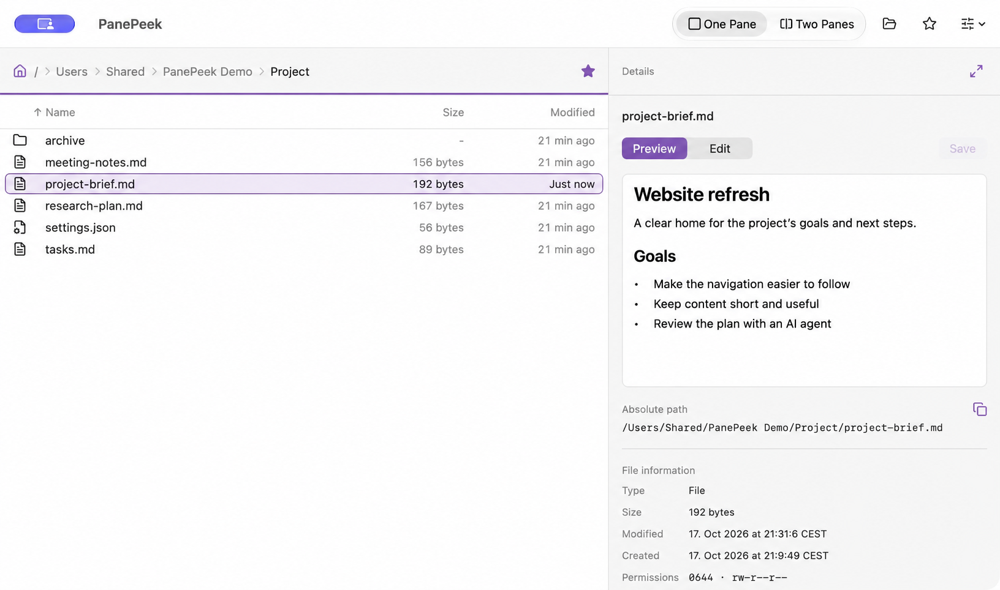
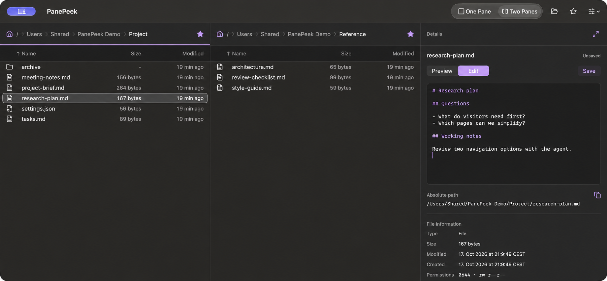

# PanePeek

PanePeek is a native macOS 26+ app for working with local documents. Browse folders beside a preview, with inline text editing and file paths you can copy to your AI agent.

## What you can do

- Browse one folder or open two side by side. Sort each file list and choose whether to show hidden files.
- Preview Markdown, SVG artwork, images and local videos. Open other supported documents in macOS Quick Look.
- Edit text in Details with syntax highlighting, then save your changes.
- Copy absolute or relative paths for selected files, ready to paste into another app.
- Organise files with familiar file actions and Finder drag and drop.
- Save favourite folders and work in separate windows. Reopening restores the last active window's folders and layout.

The [usage guide](docs/usage.md) covers everyday tasks and keyboard shortcuts. Screenshots use fictional sample documents.

## Website preview

The static website, including Home, Support and Privacy, lives in [`website/`](website/README.md), alongside the app. Its guide covers local preview, assets and launch limitations. [Website scope and validation](agent-paper-trail/specs/2026-10-17-website/README.md) are tracked separately from the native MVP.

## Build and run

See the [contributing guide](CONTRIBUTING.md#build-and-run) for build and test instructions.

## Release notes and feedback

- [Changelog](CHANGELOG.md)
- [Report a bug or suggest a change](https://github.com/bcinarli/pane-peek/issues)
- [Project plans and progress](agent-paper-trail/README.md)

## Privacy and licence

PanePeek works with files on your Mac and stores its settings locally. Cloud storage and clipboard apps can sync files or copied text. See the [privacy policy](PRIVACY.md) for details.

Free and open source under [Apache-2.0](LICENSE). Originally developed by Bilal Cinarli. See [NOTICE](NOTICE) for project credits and [icon licences](assets/lucide-LICENSE.txt) for third-party credits.
