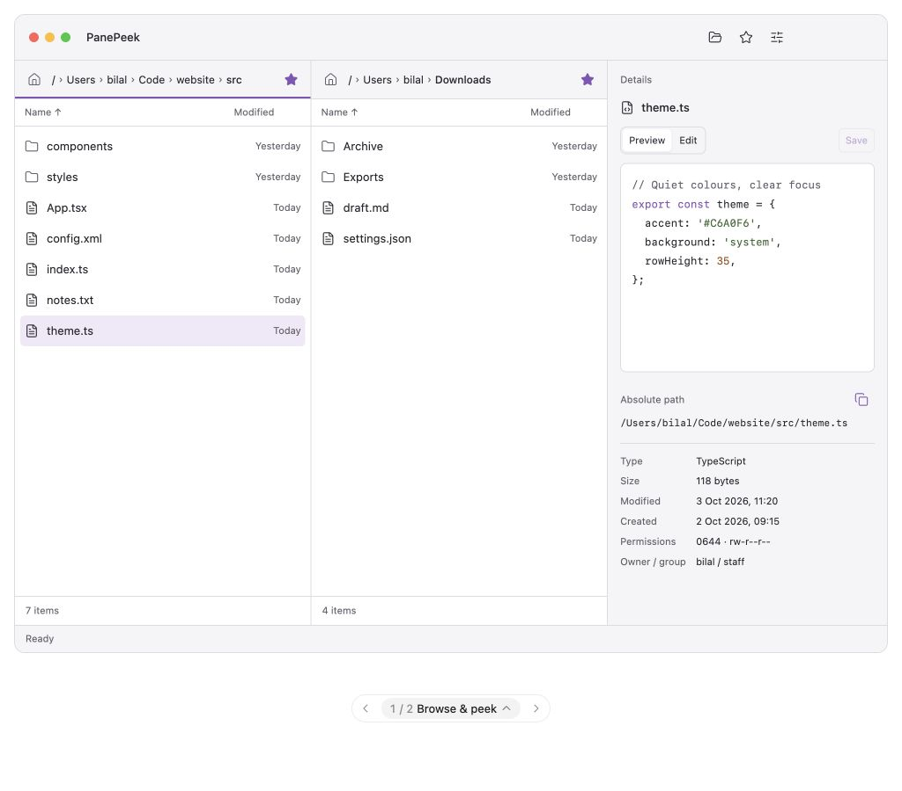
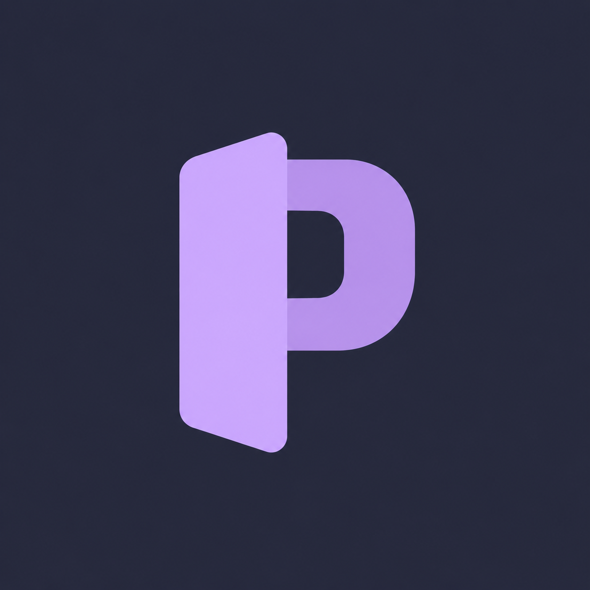

# PanePeek draft design

Status: Draft UI and logo direction accepted by Bilal on 2026-10-03. T01 Unit 2 implements static shell alignment and a development bundle icon; native feature work and final production icon acceptance remain pending.

The [spec](../../specs/001-mvp/spec.md#accepted-ui-design) owns behaviour and appearance requirements. [Decision 0003](../../decisions/0003-ui-and-logo-direction.md) records the choices and alternatives; the [plan](../../specs/001-mvp/plan.md#design-checkpoint) assigns their implementation and review.

> **Visual UI samples:** The HTML drafts demonstrate layout, colours and UI states with in-memory files and simulated actions. They are illustrative, not a functional specification or implementation to port into the app; the MVP spec and native task reviews govern behaviour.

Review these drafts for presentation and fidelity to the accepted design. Report misleading states or broken preview interactions as preview issues, separately from native app correctness and acceptance.

## Reusable sources

| File | Use |
| --- | --- |
| [peeking-p.svg](peeking-p.svg) | Transparent vector logo master: two editable paths and Mauve gradients. Use for logo placement and as the geometry source for icon artwork. |
| [app-icon-draft.svg](app-icon-draft.svg) | Generated square icon composition with a separate background layer. Uses the logo master's exact paths/gradients and original placement. |
| [export-icon.mjs](export-icon.mjs) | Regenerates the icon composition from the logo master using Node's built-in libraries. |
| [logo-preview.html](logo-preview.html) | Original raster beside the SVG redraw, with 128/64/32/16 px previews and transparent artwork on light/dark surfaces. Opens locally without network dependencies. |
| [app-draft.fragment.html](app-draft.fragment.html) | Exact editable source of the accepted UI draft: product CSS, component markup and sample interactions. |
| [app-draft.html](app-draft.html) | Standalone browser preview exported from the fragment. Preview icons/tooltips load pinned external libraries; this is design tooling, not native app code. |

The SVGs contain real paths/gradients, with no embedded raster, fonts or external assets. Named groups separate the mark and icon background. The SVG redraw was created on 2026-10-04 and compared visually with the accepted raster. Bilal accepted the reusable source pack that day. It is a draft reconstruction, not a pixel-exact conversion; keep the raster as a comparison reference. [T01 Unit 2](../../validation/t01-launchable-shell.md#unit-2-static-alignment-and-development-icon) packages the development icon with transparent margins and a rounded background. Final production refinement and small-size acceptance remain in T18.

For future agents: reuse these sources instead of generating a replacement from screenshots. Edit `peeking-p.svg` for geometry/colour changes, then run this command from the repository root:

```sh
node agent-paper-trail/design/001-mvp/export-icon.mjs
```

Treat `app-icon-draft.svg` as derived artwork. Keep its square background separate from the transparent mark; platform icon packaging and masking belong to the native icon task. The transparent master can be placed in other application artwork without rebuilding its geometry.

Edit the UI fragment for layout/interaction changes, then regenerate the browser export with the visualize skill's export tool. Both UI variants remain in the source, but Browse & peek is the accepted default. The sample highlighter is illustrative and does not implement the expanded native A15 language scope; use the spec for implementation requirements.

## Browse & peek



This is the accepted layout reference: two directory lists beside Details, with compact breadcrumbs, Home and favourite stars. The screenshot uses illustrative paths and files. The carousel control beneath the window belongs to the design preview, not the application.

The reference captures light appearance. Native system surfaces determine the final Mac presentation; the spec supplies light/dark accent direction. The wider Edit focus alternative was explored but is not the selected default. Sample dimensions guide proportions rather than fixing window or sidebar sizes.

The native [UI asset pack](../../../assets/README.md) reuses the draft's pinned Lucide geometry and accepted Mauve colours. Its [integration validation](../../validation/ui-icons-accent.md) records the current manual review gate. This does not change the production app-icon review in T18.

## Original peeking-P



Retain the curved Mauve P peeking behind the angled foreground pane. This generated raster is the accepted concept reference, not a production app icon. Native icon assets, small-size readability and bundle integration require their own review. Later variants with a more explicit rear rectangle were rejected.
