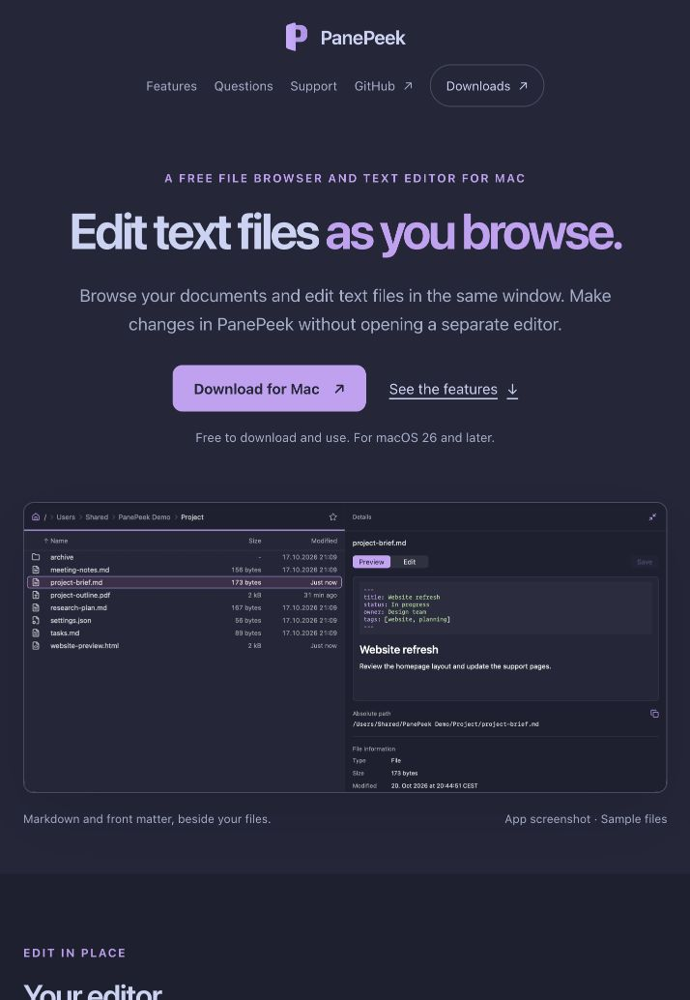

# Free-use copy

The homepage eyebrow, metadata descriptions and `llms.txt` identify PanePeek as free; its download helper and Home/Support FAQ state that it is free to download and use, with Download for Mac unchanged. Local website, generated Markdown, metadata consistency, native FAQ keyboard activation, accessible-name and light/dark responsive checks pass for the affected content, reusing the existing styles. The presented copy and layout are accepted; VoiceOver, actual browser zoom and publication remain unverified.

