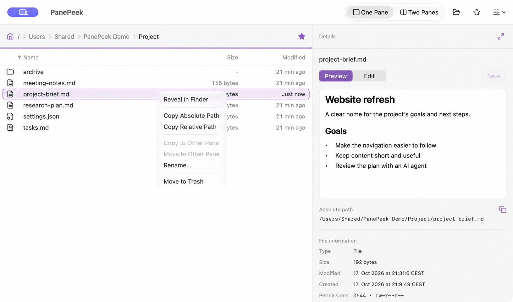

# Using PanePeek

## Start browsing

Use Go to Folder to enter a folder's full path. Home opens your home folder. Click a folder name above the file list to return to a parent folder, or double-click a folder in the list to open it. Select a file to preview it in Details.

Use Back and Forward beside the window title, or `⌘[` and `⌘]`, to revisit the active browser's folders. Each browser keeps its own history when switching between One Pane and Two Panes. Opening a new destination after going Back clears its Forward history. History starts fresh when a window opens.

`⌘`-click adds or removes items from the selection. `⇧`-click selects a range. Click a column heading to sort by Name, Size or Modified; click it again to reverse the order. Use View to show hidden files or refresh the active pane.


## Search within a folder

Click the magnifying glass after Back and Forward to reveal and focus search. An active query stays visible; an empty field collapses when you leave it. Search finds file and folder names in the current folder and its subfolders. Matching ignores letter case and preserves spaces. Each browser keeps its own search as you change folders or switch layouts. Clear the field to stop searching and return to the ordinary listing.

Results show paths relative to the search folder and retain your sort and hidden-file settings. Hidden subfolders are skipped when hidden files are off; package contents and file-link targets are not searched. Search reports inaccessible subfolders or when its 100,000-item limit is reached. Search a smaller folder when results are incomplete.

Select a result to preview it or use its normal file actions. Open Containing Folder in its item menu navigates to its parent and selects it, clearing the search. Creating an item also clears the creating browser’s search so the result is visible. If a renamed item stops matching, its browser opens the containing folder and clears the search to keep it selected. Hidden-file visibility still applies. Search does not read file contents or create an index.

## Preview documents

Details shows the main selected file's preview and information, including its full path. For Markdown, Preview shows formatted text and Edit shows the source. Markdown images appear as description links; open a link to view its image separately.

YAML front matter at the start of a Markdown file appears as a highlighted code block above the document. Edit retains the original delimiters and metadata text; previewing does not rewrite the YAML.

SVG files open as fitted static images in Preview, with XML-highlighted source in Edit. Returning to Preview shows the current draft. SVG preview and editing support UTF-8 files up to 1 MiB; scripts and external resources remain inactive. Unsupported artwork shows an unavailable state and can still be edited when its source meets those limits.

HTML files show the current draft as a rendered page, with highlighted source in Edit. Inline styles, data resources and local CSS, images and fonts in the HTML file's folder and subfolders are supported, including stylesheet imports and CSS-relative resources. Assets are limited to 8 MiB each, 32 MiB total and 128 requests per preview; symbolic links and files outside that folder are unavailable. Scripts, remote requests and form submissions are blocked; deliberate HTTP/HTTPS links open your default browser. Preview and editing share the UTF-8 / 1 MiB source limit. Pages that depend on scripts or unavailable assets will have missing content or styling.

Images and videos have read-only previews. Videos start paused and stop when you change the selection or close the preview.

PDFs have a read-only preview with page scrolling, zoom buttons and Fit Width. Preview supports files up to 32 MiB and 500 pages, with page sides up to 14,400 points. Locked or damaged documents show an unavailable message; forms and document links stay inactive. Open the file in another app for password entry or editing.

Press `Space` from the file list to open macOS Quick Look, including PDFs and other supported formats. `Escape` closes it. Quick Look shows the saved file. Unsaved edits stay in Details.

## Edit and save

Choose Edit to change a text file, then click Save to write your changes. Switching to Preview keeps your edits and shows the current Markdown text.

Edit shows source line numbers, including for Markdown, SVG and HTML. Wrapped text keeps its logical line number; the numbers stay outside copied text and saved files.

Unsaved appears beside the filename until you save or discard your edits. Actions that affect those edits ask how to handle them. Save writes the changes; Discard closes them. Cancel stops the action and keeps your edits open. Your edits also stay open if Save fails.

If another app changes or removes the file, PanePeek pauses saving and keeps your edits. Keep one app responsible for editing a file at a time.

File links have read-only previews. Open the file they point to when you want to edit it.


## Sharing with AI agents

The copy button beside the path in Details copies that path. For several files, select them and choose Copy Absolute Path or Copy Relative Path from the Edit or right-click menu. Paths are copied as plain text, one per line in list order. A file link uses the link's own path.

The screenshots use the sample folder `/Users/Shared/PanePeek Demo/Project`:

```text
Absolute: /Users/Shared/PanePeek Demo/Project/project-brief.md
Relative: project-brief.md
```

Use Go → Copy Directory Path to copy the open folder's path.

Paste a path into an agent that can read the same filesystem. For a chat with access through uploads, attach the file or paste its contents. You choose what to share in the receiving app; PanePeek works locally.



## Arrange the window

Use One Pane / Two Panes in the toolbar or View menu. One Pane keeps the folder you're using. Switching back brings the other folder back on the right.

Drag the divider beside Details to resize it. Details can use up to 66% of the window content width in One Pane and 50% in Two Panes, subject to browser minimum widths. Expand Details uses the available maximum; Restore Previous Width returns to your chosen width.

Collapse File information to give the preview or editor more height. Its state is shared across windows and remembered after relaunch. The selected file’s absolute path and copy button stay available.

## Create, rename and organise files

Choose New Text File or New Folder from the File menu. Include an extension if you want one. Names starting with a dot turn on Show Hidden Files in that pane.

Rename an item from its right-click menu, or double-click a file. `Return` confirms the new name; `Escape` cancels.

With two panes open, choose Copy to Other Pane or Move to Other Pane from the right-click menu. The destination is the folder that was open in the other pane when you started.

You can also select files and press `⌘-C`, then focus a browser list and press `⌘-V` to copy them into that folder. Choose Edit → Move Item Here (`⌘-⌥-V`) to move them instead. This works with one pane, across PanePeek windows and with files copied from Finder. The receiving folder is captured when you paste. Path-copy actions copy text and do not prepare a file transfer.

To move with Cut/Paste, select files and press `⌘-X`, then focus the receiving browser and press `⌘-V`. Cut leaves files in place until you paste. Cancelling a transfer keeps the pending move; after a partial move, the clipboard retains only files that were not moved. Copying something else cancels the pending move. Cut/Paste move intent works within PanePeek panes and windows during the current app session. In Finder, use `⌘-⌥-V` to move files.

When a name is already in use, Keep Both suggests an unused name that you can edit. Cancel stops the transfer. For regular files, Replace is also available. These choices appear in a horizontal row. Folders, packages and links offer Keep Both or Cancel.

Move to Trash (`⌘-Delete` from a browser list) sends selected items to Trash. A Trash error lists completed and remaining items so you can check the result before trying again. File transfers and Trash do not support Undo/Redo.

Drag files from Finder into a pane to copy them; hold `⌘` to request a move when allowed. You can also drag selected rows between panes or into Finder. If PanePeek asks about unsaved edits before dragging out, choose Save or Discard, then drag again. Use Refresh after Finder changes files.

If a transfer stops partway through, completed files stay in place. Check the error details and destination before trying again: a failed copy can leave an incomplete file.

Use Reveal in Finder to open a folder or locate a file in Finder.

## Favourites

Click the star beside the folder path to save or remove it. Favourites are shared across panes and windows, and stay saved after quitting.

Use the toolbar Favourites button to search saved folders by name or path. Each result has buttons to open the folder in the active pane or remove it from Favourites. The menu-bar Favourites menu offers those actions too. It shows folder names, adding parent folders only to distinguish repeated names.

## Windows and reopening

File → New Window opens a separate window with one pane, expanded Details and its own folders and unsaved edits. The first launch uses this layout too; use One Pane / Two Panes to choose your working layout.

When you reopen PanePeek, it restores the last active window's folders and layout. Selection and sorting start fresh, with hidden files concealed. Save your edits before quitting.

## About and privacy

PanePeek → About PanePeek shows the version and build number. Select the version text and press `⌘-C` to copy it for a report. Privacy and Acknowledgements open local documents you can read offline.

See the [privacy policy](../PRIVACY.md) for file access and local storage details.

## Keyboard shortcuts

File actions use the active pane. Text fields and the editor handle their usual typing shortcuts. Paste copies files, or moves files previously cut in PanePeek. Undo and Redo apply to text edits.

### Navigation and previews

| Action | Shortcut |
| --- | --- |
| Go to Folder | `⌘-L` |
| Enclosing Folder | `⌘-Up` |
| Open selected folder | `⌘-Down` |
| Move selection up or down | `Up` or `Down` |
| Extend selection up or down | `⇧-Up` or `⇧-Down` |
| Select all visible rows | `⌘-A` |
| Open or close Quick Look | `Space` |
| Close Quick Look or clear list selection | `Escape` |
| Open selected item’s context menu | `⇧-F10` (`Fn` may be needed) |

### Files and paths

| Action | Shortcut |
| --- | --- |
| New Text File | `⌘-⌥-N` |
| New Folder | `⌘-⇧-N` |
| Rename selected item | `Return` or `⌘-⇧-R` |
| Copy selected files | `⌘-C` |
| Cut selected files for a later move | `⌘-X` |
| Paste files into the active folder | `⌘-V` |
| Move clipboard files here | `⌘-⌥-V` |
| Move selected files to Trash | `⌘-Delete` |
| Copy absolute paths | `⌘-⌥-C` |
| Copy relative paths | `⌘-⌥-⇧-C` |

### Text editing

| Action | Shortcut |
| --- | --- |
| Save changes | `⌘-S` |
| Undo text edits | `⌘-Z` |
| Redo text edits | `⌘-⇧-Z` |

### View and Details

| Action | Shortcut |
| --- | --- |
| Refresh | `⌘-R` |
| Show hidden files | `⌘-⇧-period` |
| Make Details wider | `Control-⌘-Left` |
| Make Details narrower | `Control-⌘-Right` |

### Dialogs and popovers

| Action | Shortcut |
| --- | --- |
| Confirm a dialog or filename | `Return` |
| Cancel a dialog, rename or popover | `Escape` |

### Windows and app

| Action | Shortcut |
| --- | --- |
| New window | `⌘-N` |
| Close window | `⌘-W` |
| Close all windows | `⌘-⌥-W` |
| Minimise window | `⌘-M` |
| Enter or leave full screen | `Control-⌘-F` |
| Hide PanePeek | `⌘-H` |
| Hide other apps | `⌘-⌥-H` |
| Quit PanePeek | `⌘-Q` |

See [Apple’s keyboard shortcut reference](https://support.apple.com/en-us/102650) for standard macOS text navigation and window controls.

## Formats and limits

| Content | Current support |
| --- | --- |
| Text and inline editing | UTF-8 files up to 1 MiB. |
| Images | Formats supported by macOS, up to 32 MiB and 64 million pixels. Animations show a still frame. |
| Video | Local videos that contain their own media and are supported by macOS. Audio-only and protected files show file information. |
| Other documents | File information and Quick Look where macOS supports the format. |
| Folders and packages | File information. The file list shows `-` for folder sizes; packages behave as files. |

Syntax highlighting covers common code and config files, including Swift, JSON, JavaScript/TypeScript and Python. Other UTF-8 text stays editable. HTML uses rendered Preview and highlighted source Edit.
